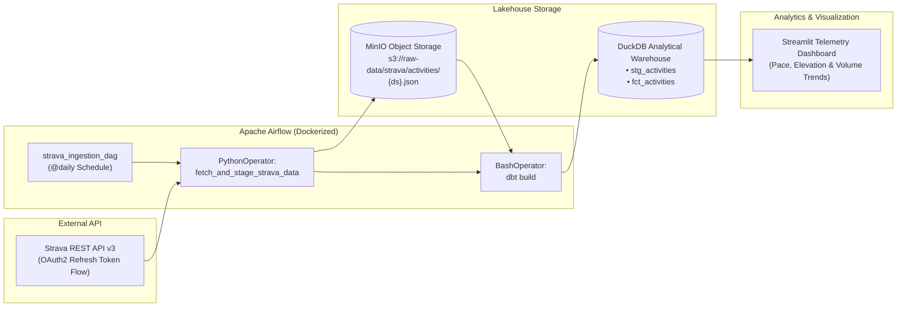

# 🏃‍♂️ Strava Telemetry ELT Lakehouse & Analytics Pipeline

A containerized end-to-end **Modern Data Stack (ELT)** project that ingests athlete telemetry from the **Strava REST API**, lands raw partitioned JSON in an S3-compatible data lake (**MinIO**), transforms it into analytics-ready tables using **dbt** and **DuckDB**, and serves interactive performance insights via **Streamlit**—all orchestrated by **Apache Airflow**.

---

## 🏗️ System Architecture



---

## ✨ Engineering Highlights

- **Containerized Multi-Service Infrastructure**: Spin up **Apache Airflow** (Webserver + Scheduler + Postgres metadata DB) and **MinIO S3** object storage with a single `docker-compose up -d` command.
- **Automated OAuth2 Token Refresh**: Custom `StravaClient` (`include/strava_client.py`) automatically exchanges long-lived refresh tokens for short-lived bearer tokens prior to incremental activity extraction.
- **Date-Partitioned Data Lake Landing**: Raw API payloads are partitioned by Airflow execution date (`s3://raw-data/strava/activities/{{ ds }}.json`) using `s3fs` for reproducible backfills.
- **In-Process Lakehouse Transformation (`dbt` + `DuckDB`)**:
  - `stg_activities`: Reads partitioned raw JSON directly from MinIO S3 via DuckDB's `httpfs`/`s3` extension, enforcing schema types and deduplication.
  - `fct_activities`: Materializes analytics-ready telemetry metrics (`distance_km`, `moving_time_minutes`, `elevation_gain_meters`, `avg_speed_kmh`) validated by `dbt` schema tests (`unique`, `not_null`).
- **Interactive BI Layer**: Streamlit analytics app (`dashboard.py`) queries the DuckDB warehouse directly for sub-second analytical visualizations.

---

## 📂 Project Structure

```text
├── dags/
│   └── strava_ingest_dag.py          # Airflow DAG orchestrating S3 ingestion -> dbt build
├── include/
│   ├── strava_client.py              # OAuth2 token refresh & paginated Strava API client
│   └── debug_strava.py               # Connectivity diagnostic utility
├── dbt_project/
│   ├── dbt_project.yml               # dbt project configuration
│   ├── profiles.yml                  # DuckDB + S3 (MinIO) connection profile
│   └── models/
│       ├── schema.yml                # Data quality tests (not_null, unique)
│       ├── staging/
│       │   └── stg_activities.sql    # S3 raw JSON extraction & normalization
│       └── marts/
│           └── fct_activities.sql    # Enriched athlete activity fact table
├── dashboard.py                      # Streamlit interactive analytics dashboard
├── auth_helper.py                    # CLI helper for initial OAuth2 refresh token exchange
├── docker-compose.yaml               # Multi-container stack (Airflow, Postgres, MinIO)
└── requirements.txt
```

---

## 🚀 How to Run

### 1. Prerequisites
- [Docker & Docker Compose](https://docs.docker.com/get-docker/)
- Python 3.9+ (for local Streamlit dashboard)

### 2. Strava API & OAuth2 Setup
1. Create an API application in your [Strava API Settings](https://www.strava.com/settings/api) to obtain your **Client ID** and **Client Secret**.
2. Copy `.env.example` to `.env` and run the interactive OAuth helper to generate your **Refresh Token**:
   ```bash
   pip install requests python-dotenv
   python auth_helper.py
   ```
3. Populate `.env`:
   ```env
   STRAVA_CLIENT_ID=your_client_id
   STRAVA_CLIENT_SECRET=your_client_secret
   STRAVA_REFRESH_TOKEN=your_refresh_token
   ```

### 3. Launch the Lakehouse Infrastructure
```bash
docker-compose up -d
```

### 4. Trigger the Airflow Pipeline
1. Open the Airflow UI at `http://localhost:8080` (login: `airflow` / `airflow`).
2. Unpause and trigger **`strava_ingestion_dag`**.
3. Airflow will:
   - Extract incremental activities from the Strava API.
   - Land date-partitioned JSON files in MinIO (`s3://raw-data/strava/activities/`).
   - Execute `dbt build` (models + data quality tests) into `data/strava.duckdb`.

### 5. Launch the Analytics Dashboard
```bash
pip install -r requirements.txt
streamlit run dashboard.py
```
Visit `http://localhost:8501` to explore the transformed warehouse metrics.

---

## 🛠️ Tech Stack

| Layer | Technology |
| :--- | :--- |
| **Orchestration** | Apache Airflow 2.x |
| **Ingestion** | Python, `requests`, `s3fs`, OAuth2 |
| **Data Lake (Raw)** | MinIO (S3-Compatible Object Storage) |
| **Data Warehouse** | DuckDB (`httpfs` / S3 direct query) |
| **Transformation & QA** | `dbt-core`, `dbt-duckdb` |
| **BI / Visualization** | Streamlit, Pandas, Plotly |
| **Infrastructure** | Docker, Docker Compose, PostgreSQL |
